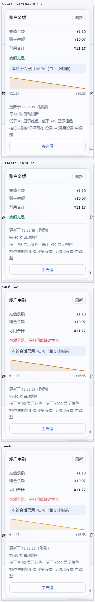
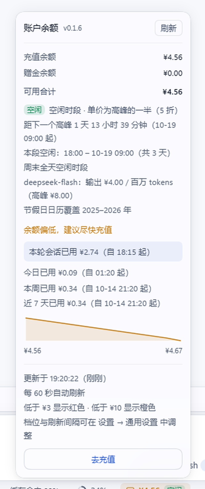

# 余额徽章 · dsh-balance-pill v0.1.6

在 DeepSeek Harness 输入框下方的状态行**末尾**加一枚余额徽章：颜色随余额档位变化，
点开是充值/赠金明细、**余额趋势**、**今日已用**、**本周已用**、**近 7 天已用**、
**本轮会话消耗**与充值入口；v1.3 起徽章上还标出**当前处于高峰还是空闲计费时段** ——
DeepSeek 空闲时段的单价是高峰的一半，面板因此给出两个时段的倒计时与
「等到空闲再跑能省多少」。余额掉档或时段切换时会浮出提醒，全部行为都在
「设置 → 通用设置」里调。

v0.1.6 是**版本号重置版**（1.5.0 → 0.1.6）：主线是把账算对 —— 充值不再把
「今日/本周已用」归零，并补上「近 7 天已用」；同时修掉切换口径弹假提醒、
改设置后速度行消失、`null` 被当成 0 等静默缺陷。设置键、存储键与挂载点全部不变。



> 上图是真实 GUI 的离屏截图（`verify/shot-pill.mjs`），面板里的折线、会话消耗、
> 明细行都是插件在运行中的应用里真画出来的，不是设计稿。它取自 v1.2 的面板；
> v1.3 新增的时段区块见下面[「计费时段」](#计费时段高峰--空闲)一节，
> v1.4 / v1.5 / v0.1.6 新增的行见[「0.1.6 更新内容」](#016-更新内容)。

## 0.1.6 更新内容

### 修复：充值当天，今日/本周消耗被归零（这一版的主线）

v1.5 及更早用「窗口最早金额 − 最晚金额」算消耗。只要当天充过一次值，
差额就是负数，随后被归零：

```
08:00 ¥20 → 09:00 ¥15（花 5）→ 10:00 ¥35（充 20）→ 11:00 ¥32（花 3）
旧：20 − 32 = −12 → 0     ← 用户明明花了 ¥8
新：5 + 3 = 8
```

现在改为**逐段累加下降量**：相邻样本里只把下降计入消耗，充值那一跳直接跳过。
`spendInDay` / `spendInWeek` 与新增的 `spendInWindow` 共用这本账；同毫秒重复
样本会先去重，外部存储写乱的样本会先排序，避免把顺序错误当成消耗。

### 新增：面板「近 7 天已用」

「本周已用」在周一早上只含当天，回答不了「最近一周一共花了多少」。新增一行：

```
今日已用 ¥0.24（自 01:47 起）
本周已用 ¥1.86（自 10-13 08:20 起）
近 7 天已用 ¥3.42（自 10-11 09:10 起）
```

与今日/本周同一套规则（同口径、同币种、逐段下降），窗口固定 7 天、跟随已有的
历史采样 —— **不新增设置项，也不新增存储键**。窗口内样本不足两个时不渲染。
落在 `<p class="dbp_recent" data-balance-recent-spend>`，位置在「本周已用」之后、
趋势图之前。



> 真实 GUI 离屏截图（2026-10-17，本机运行中的客户端）。标题旁是 `v0.1.6`，
> 「本周」与「近 7 天」的起点都带上了 `10-14` 日期，倒计时显示到分钟。

### 修复：切换「徽章数字」口径会弹一张假的「余额不足」

从「可用合计」切到「仅充值」时，金额与档位会同时跳变；旧状态机只看金额有没有
变化，于是把新口径的较低金额当成一次真实掉档。现在每次读数带 `configKey`
（口径 + 阈值 + 币种）：配置变化时静默跟随档位、不弹卡；配置稳定后真实的
掉档仍然照常提醒。

### 修复：改阈值 / 口径后「近期消耗」整行消失

重算路径把同一份读数同时当成 `previous` 与 `summary`，`elapsed = 0`，速度必然
是 `null`。现在直接沿用上一条视图模型的速度，改设置后面板不再闪没。

### 修复：余额暂时不变时，速度与耗尽预估消失

旧实现每次成功轮询都覆盖速度基准，下一次读数 `spent = 0` 就判定不出速度。
现在金额没变时保留旧基准，直到金额真正变化；基准最多回看 6 小时
（`RATE_MAX_ELAPSED_MS`），超过就放弃这次估算，避免把半天平均值冒充「近期速度」。

### 修复：`null` 被当成 0（第三批）

- `pricingSnapshot({balance: null})` 不再变成「余额 ¥0」并推出「撑不到下一高峰」；
- `tzOffsetMinutes: null` 不再变成 UTC（整体偏 8 小时）；
- `now: null` 不再落到 1970 年；
- `pollMs: ''` / `false` 不再变成「仅手动」（否则插件静默停止轮询）；
  数值 `0` 与 `'0'` 仍是明确的「仅手动」。

### 修复：多日窗口的「自 HH:MM 起」读成今天

「本周已用（自 08:20 起）」在周五会被读成今天早上。新增 `formatBillingMoment()`：
同一天给 `HH:MM`，跨天补 `MM-DD`；「本周」「近 7 天」「本轮会话」都改用它。

### 修复：跨天倒计时只显示整数天，一整天不走字

`formatCountdown` 在「天」档只返回「1 天」，而真实剩余可能是 1 天 23 小时 ——
面板看起来像冻结了。现在跨天也补上小时 / 分钟（如「1 天 2 小时 13 分钟」），
按分钟走字；不足一小时仍按分钟 / 秒显示。

### 变更

- **面板限高滚动**：面板按徽章上方的实际空间设置 `max-height`，内容超过时在面板
  内滚动，小窗口或大字号下不会再裁掉标题与刷新按钮。
- **面板标题旁显示版本号** `v0.1.6`（`data-balance-version`），报问题时不用再猜。
- 构建期产物断言从 26 项增至 **34 项**；测试从 126 项增至 **136 项**。
- **版本号重置**：`package.json` / `CHANGELOG.md` / `PLUGIN_VERSION` 三处一致，
  设置键、存储键、挂载点与已有配置全部不变，升级无需迁移。

## v1.5 更新内容

### 修复：时段提醒的冷却会把反方向的卡片挡掉（这一版的主线）

v1.4 及更早的时段提醒状态机只有一个 `alertedAt`，所有方向的提醒共用同一小时冷却。
于是这个时序会被静默吞掉一张卡：

```
11:30  进入高峰  → 提醒（alertedAt = 11:30）
12:00  进入空闲  → 距上次提醒仅 30 分钟 < 1 小时冷却 → 被挡掉
```

而「现在便宜了」恰恰是用户最想看到的那张卡 —— 高峰时段里用户正在花钱，等到 12:00
忽然半价，这是唯一值得主动告诉他的时刻。

现在冷却**按方向分账**：`alertedAtPeak` 与 `alertedAtOffPeak` 各走各的窗口，
一个方向提醒过不影响另一个方向。旧字段 `alertedAt` 仍然写回（保留向后兼容），
但不再参与判定。

| 规则 | 行为 |
| --- | --- |
| 同方向连续切换 | 仍受 1 小时冷却保护（不会连环弹卡） |
| 反方向切换 | **不受**另一方向的冷却影响，该提醒就提醒 |
| 冷却期内 | 原样保留状态、不推进 period —— 冷却一过就补上，切换不会被永久吞掉 |

### 修复：`null` / 空串被当成合法的 0 阈值

`normalizeSettings()` 的 `numberOr()` 直接 `Number(value)`，而 `Number(null)`、
`Number('')`、`Number(false)` 全都是 `0`，能通过 `Number.isFinite` 与 `>= 0` 两道检查。
后果是**任何余额都判红**：用户把设置里的阈值输入框清空，徽章立刻变成「余额不足」，
而界面上看不出任何异常。

现在只接受数字，或**非空**的数字字符串，其余一律回落默认值。这与 v1.4 修
`billingDayOf`（`Number(null)` 是 1970-01-01）、v1.3 修 `tariffEpochOf` 是同一条教训：
**`null` 不是 `0`**。

### 新增：面板「本周已用」

「今日已用」回答「今天花了多少」，「本轮会话」回答「这次对话花了多少」，
但没有一行回答「这周一共」—— 而周一对账正是最需要它的时候。

```
本轮会话已用 ¥0.99（自 15:42 起）
今日已用 ¥0.24（自 01:47 起）
本周已用 ¥1.86（自 10-13 08:20 起）
```

与「今日已用」同一套四条规则（只算同周、只算同口径 `basis`、只算同币种、差额为负
时归零；v0.1.6 起改为「逐段下降求和」，充值不再把已花掉的钱归零），只是按
**北京时间 ISO 周**（周一为起点）切分。历史最长保留 7 天，所以
「本周」在周日晚上与「最近 7 天」几乎重合；周一早上则只含周一当天 —— 这正是它
存在的意义：**周一对账不需要看上周**。

当天样本不足两个时**不渲染这一行**（而不是显示 ¥0）。

### 新增：「近期消耗」标明按哪个时段折算

跨高峰/空闲切换时这个数会跳变（同样的钱在空闲时段能用两倍时长），不标注会让用户
以为是余额算错了。空闲时段现在用独立文案：

```
近期消耗 -¥1.20（空闲价），按此速度约可用 7.5 小时
```

### 变更

- **「本轮会话已用」的时刻写法改为「自 HH:MM 起」**（与「今日已用」「本周已用」统一）：
  「3 分钟前」这类相对写法每秒都在贬值，而「从几点开始」是稳定的。
- 构建期产物断言从 19 项增至 **26 项**；新增 `alertedAtPeak` / `alertedAtOffPeak`
  两条尤其值得锚住 —— 退回单一 `alertedAt` 时功能看起来完全正常，只有特定时序才露馅。
- 设置键与存储键**全部不变**，**没有新增设置项**（「本周已用」跟随已有历史采样，
  分方向冷却是内部实现），旧配置无需手工迁移。
- 测试套件**按源码重建**（126 个用例）。原 `tests/runtime.test.mjs` 在本次会话开始时
  已损坏到不可恢复（672 行被写成 `U+FFFD`、316 处行尾注释吞掉了自己的换行符），
  修复过程中又被零填充成 NUL 字节。原委与重建范围写在
  [`CHANGELOG.md` 的 1.5.0 一节](CHANGELOG.md#150)，这里不重复。
  **源码模块与 `verify/out/` 的截图未受影响**（已全库扫描确认）。

## v1.4 更新内容

### 修复：看门狗从时钟跳变中自愈（这一版的主线）

v1.3 的 166 项单测与构建**全绿**，但真实 GUI 验证台报出「进入空闲」方向的提醒卡
75 秒内一张都没出现。逐层排查（只读探针直接读组件的 fiber props）确认了根因：

> 看门狗由 `setInterval(run, 30000)` 驱动，而 effect 的依赖是 `[settings, tariff]`
> 两个**恒定引用** —— 于是「时钟前进」本身永远不触发重算。注入 12:30 后 75 秒内
> `tariff.latest().now` **冻在 10:30**；手动调一次 `tick()` 立刻产出正确卡片。
> **状态机是对的，错的是宿主侧那层驱动。**

这不只是验证台才有的问题 —— 真实用户会遇到同一个形状：笔记本**合盖唤醒**、
**NTP 校时**、**后台标签页被节流**，都会让时钟跨过时段边界而看门狗毫不知情，
本该提醒你的那次「进入高峰」被静默吞掉。

现在改成**自愈的链式调度**：

| 机制 | 作用 |
| --- | --- |
| `nextTickDelay()` 重排下一次唤醒 | **对齐到下一个时段边界**（边界都是整点，可预知），提醒准时且不更费 CPU |
| `visibilitychange` / `focus` 立即补一拍 | 覆盖休眠唤醒与切回标签页 |
| `drift()` + `TARIFF_MAX_GAP_MS`（2×tick） | 识别时钟跳变；跳变**不改变状态机的推进**，于是跳变后的**第一拍**就补上卡片 |

实测：一次性把时钟从 14:30 推到 19:00（跨过 18:00 边界），
`drift().jumped=true` 且「进入空闲」卡片出现。

### 修复：另外两条

- **改「时段切换提醒」开关不能立刻生效**：提醒宿主的 effect 依赖是 store 对象本身
  （引用恒定），而 v1.3 的契约里写着「也由它负责在设置变化时 tick」—— 这句话直到
  v1.4 才成立。改为订阅**值**，设置一变立刻重排看门狗。
- **峰谷预估算错了一倍**：`offPeakRemainingMs` 的实现是
  `remainingMs * (1 / 0.5 - 1)`，代入得系数 1，于是它**恰好等于** `remainingMs`。
  而字段名与唯一使用点（非人民币币种下的「同样的钱在空闲时段能用约 {duration}」）
  要的都是**能用多久**。后果是那句文案把时长少报一半：余额 $9、速度 $2/h 时显示
  「约 4.5 小时」，正确答案是 **9 小时**。现在语义统一为「能用多久」，
  「省下多少」另立为 `offPeakSavingMs`，三个量的关系用不变量锁进测试。

### 新增：面板「今日已用」

v1.2 起面板能回答「本轮会话花了多少」，但答不了「今天一共花了多少」。
历史里已经有 7 天的采样点，按**计费日**（北京时间自然日）切一刀就能算出来，
**不需要新增存储**：

```
本轮会话已用 ¥0.99（自 1 小时前）
今日已用 ¥0.24（自 01:47 起）
```

四条规则都有测试锁住：只算同一天、只算同口径（`basis`）、只算同币种、
差额为负（当天充过值）时归零。当天样本不足两个时**不渲染这一行**（而不是显示 ¥0）。

它**不受「显示余额趋势」开关影响** —— 只依赖历史采样，与折线图是两件事。
真实 GUI 实测里 `showTrend=false` 的变体仍然显示这一行。

### 新增：徽章上的余额耗尽预估

面板里早有「按此速度约可用 {remaining}」，但要展开才看得到；而「今天就会用完」
最好在不点开的时候就能察觉。徽章因此多一个属性与 `title` 末尾的一句话：

```
data-balance-runout="2026-10-15T20:32:51.868Z"
title="账户余额 · ¥1.63 · 按当前速度约 10-16 04:32 耗尽"
```

触发条件**三选三**：有成功读数、有正的消耗速度、预估耗尽落在 **24 小时内**。
任一不满足时属性**不存在**（不是空串）—— 沿用 v1.3 对 `data-tariff` 的
「不知道就不要冒充一个值」。它跟随已有的「显示消耗速度」开关，**不新增设置项**。

### 变更

- `tariff-service.js` 新增 `TARIFF_MAX_GAP_MS` / `nextTickDelay()` / `lastTickAt()` /
  `drift()`；`tick()` 与 `snapshot()` 改为**优先采用显式 `now`**，
  修掉 v1.3 里「调用方传 now、内部又各算一次」的两套口径。
- 构建期产物断言从 15 项增至 **19 项**；测试从 166 项扩到 **185 项**（新增 19 项）。
- 设置键与存储键**全部不变**，旧配置无需手工迁移。
- 新增文档：[`docs/V14-CONTRACT.md`](docs/V14-CONTRACT.md)（冻结契约）与
  [`docs/V14-DEFECTS.md`](docs/V14-DEFECTS.md)（缺陷证据链，含一个**被证伪**的假设）。

## v1.3 更新内容

### 新增：计费时段（高峰 / 空闲）

DeepSeek 的价格不是常量：**空闲时段单价是高峰时段的一半**。于是「现在处于哪个时段」
本身就是要被看见的信息，v1.3 把它做成一等公民：

- **徽章上的时段徽标**：状态行徽章上标出「高峰 / 空闲」，可在设置里关掉
  （关掉后该元素**不存在**，不是隐藏）；
- **面板里的时段区块**：当前时段与单价口径、下一个时段的 1 秒倒计时、本段空闲的
  起止区间，以及高峰时「同样跑 2 小时，留到空闲时段只花一半」；
- **时段切换提醒**：高峰开始、空闲开始时各浮出一张提示卡，默认**关**。

官方口径、两个最容易算错的地方、价格表与来源、三个新设置项、提醒规则，
以及节假日日历的来源与每年更新方式，都在下面[「计费时段」](#计费时段高峰--空闲)一节。

### 修复

- **提醒卡在真实 GUI 里从来没有渲染出来**（v1.2 的余额跨档提醒也一样）：宿主挂载点
  的渲染器用 `useSyncExternalStoreWithSelector(subscribe, () => store.getSnapshot(), …)`
  订阅我们注入的「当前卡片」仓库，而仓库只提供了 `get`。条目第一次渲染就抛
  `TypeError: …getSnapshot is not a function`，宿主把它当成**条目崩溃**并永久摘掉该
  条目（`abdicate`）—— 于是提醒卡一张都不会出现，控制台里只剩一行不显眼的错误。
  `getSnapshot` 是 `useSyncExternalStore` 的契约名、不是可选的别名：现在仓库同时提供
  `getSnapshot` 与 `get`（同一个读取函数），并把「产物里必须有 `getSnapshot`」加进
  构建期断言。**余额跨档提醒与新增的时段提醒共用这个仓库，所以这条同时修活了 v1.2 的
  余额提醒** —— 之前实测记录里「提醒没抓到」的现象到这里才对上根因。
- **改设置会把面板误标成「本次刷新失败」**：改阈值 / 数字口径 / 币种时面板用上一次
  的读数重算，而重算走的是「这次读取返回了什么」那条入口 —— 手上没有新的读取结果，
  视图模型于是判成「没读到 → 旧数据过期」，徽章被标成 `stale`、面板顶部出现
  「⚠ 本次刷新失败」。根因是把**数据来源**（这条数据是刚读到的，还是沿用上一次的）
  与**数据新鲜度**（它有没有过期）混成了一个字段。v1.3 新增 `refreshedViewModel()`：
  重算路径显式走「手上有可用读数」的分支（`status='ready'`、`stale=false`），
  只重算与设置相关的口径、档位与速度；另加字段 `effective` 区分两者 ——
  重算得到的是「沿用上一次读数」（`effective=false`），真的读到新数据才是 `true`。
- **调休补班日不解释「今天为什么有高峰时段」**：日级判定里 `makeup-workday` 只在
  分类时用过，时段判定的「原因」永远取不到它，于是补班周末的面板不会给出
  「今天调休补班，按工作日计费」。那天 09:00 起真的会按高峰计费，用户看到空闲徽标
  只会以为插件算错。现在补班日的空闲时段直接返回该原因，高峰时段则由「当天是补班日」
  这个事实触发，两条路径都会在面板补上那句说明 —— 补班日全天都能看到。
- **切换「徽章数字」口径后趋势图会画出一条假的斜率**：历史采样记的是当时的展示金额，
  口径由设置决定。把口径从「可用合计」改成「仅充值」之后，同一张图前半段是合计、
  后半段是充值额 —— 两条数量级不同的序列被连成一条线。现在样本带上记录时的口径
  （`basis`），画图只取与当前口径一致的样本；一致样本不足两个时不画（沿用 v1.2 的
  「一个点画不出趋势」）。同时历史**写入时**也按 `MAX_AGE_MS` 裁剪：原来只在加载时
  裁一次，页面一直开着就会攒下超过 7 天的样本。
- **「本段空闲」的起点被截到当天 00:00，低报好几天**：查找本段空闲的起点时，如果
  往回找不到「前一刻还是高峰」的那个变化点，实现会退回当日日界 —— 于是一段 8 天的
  国庆空闲会从 10-02 00:00 算起（实际是 09-30 18:00），面板上「共 N 小时」直接少报。
  现在锁住不变量：本段空闲的起点前一刻必须是高峰、终点时刻必须是高峰。
- **时段边界候选的搜索跨度两个方向都不够**：候选边界原来只在今天前后一两天里找 ——
  **向前不够**时（周五 17:00、法定节假日中段）「下一个高峰」直接变成「没有」，
  面板上「距下一个高峰」整行消失、本段空闲区间被截到当天 24:00；**向后不够**时就是
  上一条的低报（国庆 8 天、春节 9 天、周末第二天、劳动节 5 天这类两天以上前就开始的
  空闲）。现在两个方向都扩到 30 天（春节最长 9 天，余量充足）。修好后的实例：
  国庆中段（10-02 12:00）→ 本段空闲 **09-30 18:00 – 10-08 09:00**；周末第二天
  （10-18 12:00）→ **10-16 18:00 – 10-19 09:00**；春节（02-18 12:00）→
  **02-14 18:00 – 02-24 09:00**。同时把「下一次切换」的语义收紧为「下一次**真正改变
  时段**的时刻」：23:30 的下一个边界是 00:00，但前后都是空闲，那不算切换。

### 变更

- 徽章新增 `data-tariff="peak|off-peak"` 与 `data-tariff-reason` 两个属性
  （时段与判定依据），徽标本身是 `<span class="dbp_tariff" data-balance-tariff="…">`。
- 新增源文件：`src/client/pricing.js`（时段判定与价格表，纯函数）、
  `src/client/calendars.js`（内置法定节假日日历）、`src/client/tariff-alert.js`
  （时段切换提醒状态机）、`src/client/tariff-service.js`（时段看门狗：算快照、
  推进提醒状态机）与 `src/client/readings.js`（最近一次成功读数的共享槽位）；
  `format.js` 另增 5 个纯函数（北京时间时刻 / 日期、时段区间文本、倒计时、单价文本）。
- 面板倒计时精确到秒：新增一个 1 秒计时器，**只在面板打开时启用** ——
  没人盯着的时候不必每秒重渲染；面板关着时快照按 30 秒分桶重算
  （时段边界都是整点，30 秒内不可能跨过两次）。
- 构建期产物断言从 7 项增至 15 项（新增价格来源 URL、`panel.tariff.` 与
  `alert.tariff.` 词条前缀、`data-balance-tariff`、时段提醒卡片的 `kind` 标记、
  时段看门狗接线、`showTariff`，以及提醒仓库的 `getSnapshot` 契约 —— 缺了它
  宿主浮层会在首次渲染时把条目永久摘掉，见上面「修复」第一条）。
- 测试从 97 项扩到 166 项（新增 69 项）：时段判定与边界（含午休、跨日、
  长跨度空闲区间）、价格表与换算、提醒状态机、徽标与面板时段区块、设置行三行。
- 设置新增三项，**存储键不变**（仍是 `dsh-balance-pill:settings`，没有新增键）。

## 计费时段（高峰 / 空闲）


> 同样是真实 GUI 的离屏截图：空闲时段的面板，时段区块插在余额明细与档位提示之间。

### 官方规则

官方口径（[DeepSeek 开放平台 · 模型 & 价格](https://api-docs.deepseek.com/zh-cn/quick_start/pricing)，2026-10 抓取）：

> 北京时间**周一至周五（不含中国法定节假日）** 9:00–12:00、14:00–18:00 为**高峰时段**；
> 其余时段，**包括周末及中国法定节假日全天**均为**空闲时段**。

等价的 UTC 说法是 MON–FRI 01:00–04:00 与 06:00–10:00 UTC。

时段固定按**北京时间**判定，与运行机器的时区无关：代码用的是固定 +08:00 偏移，
不读机器的 `getTimezoneOffset()`，也不随系统时区设置变化 —— 你在哪个时区，
计费都按北京时间的 9 点划线。

两个最容易算错的地方，插件都按官方口径处理：

| 容易算错 | 实际口径 |
| --- | --- |
| 「白天都贵」 | **午休 12:00–14:00 是空闲时段**；高峰只有 9:00–12:00 与 14:00–18:00 两段 |
| 「周末一律半价」 | **调休补班的周末是工作日**（多数是周六，也有周日），那天照样有高峰窗口；反过来，法定节假日里的工作日全天空闲 |

面板会把判定依据一起给出来：午休、周末、法定节假日、调休补班各有各的说明
（夜间与高峰窗口本身不必解释 —— 徽标已经说明了现状），用户不必自己反推
「为什么现在是空闲」。徽章元素上另带 `data-tariff-reason` 属性，便于样式与诊断。

### 价格表

单位：元 / 百万 tokens。空闲时段单价是高峰时段的一半，两个模型都是这样：

| 模型 | 输入(命中) 空闲/高峰 | 输入(未命中) 空闲/高峰 | 输出 空闲/高峰 |
| --- | --- | --- | --- |
| `deepseek-flash` | 0.02 / 0.04 | 1 / 2 | 4 / 8 |
| `deepseek-v4-pro` | 0.15 / 0.30 | 4.5 / 9.0 | 13.5 / 27.0 |

来源：[https://api-docs.deepseek.com/zh-cn/quick_start/pricing](https://api-docs.deepseek.com/zh-cn/quick_start/pricing)（2026-10 抓取）。

价格表是**内置**的，运行时不去抓网页：时段判定与价格换算每次渲染都要用，
不能因为网络不通就给出错的结论。出处就是上面这条官方链接（2026-10 抓取），
它同时写在 `pricing.js` 的 `MODELS[].source` 里，并作为构建期断言锚在产物里。
两个模型之间的相对价格不成单一倍数（pro 的输入未命中是 flash 的 4.5 倍、输出是
3.375 倍），所以三个数逐项列出，不靠一个倍数推导。

面板只把价格用在**输出单价**上：显示当前时段的输出单价与高峰对照价。余额币种不是
人民币时，价格表不参与金额换算 —— 人民币单价乘美元余额没有意义，此时面板改用
「同样的钱在空闲时段能用约多久」这类不跨币种的表达。

### 三个新设置项

三行都在「设置 → 通用设置」的「显示余额趋势」之后，前面另有一组标题
「计费时段」把这套规则讲一遍（否则打开开关的用户仍然不知道为什么会有两个价）：

| 设置项 | 默认 | 作用 |
| --- | --- | --- |
| 显示计费时段 | **开** | 徽章上的高峰 / 空闲徽标；关掉后该元素不存在 |
| 价格口径 | `deepseek-flash` | 面板里的价格与预估按哪个模型计算（`deepseek-flash` / `deepseek-v4-pro`） |
| 时段切换提醒 | **关** | 高峰开始与空闲时段开始时浮出一张提示卡 |

两个默认值刻意不同：时段徽标只是信息，不打断任何人，默认开；提醒会占用注意力，
默认关。这和「余额跨档提醒」默认开并不矛盾 —— 掉档意味着任务可能中断，
时段切换只是价格变了。

### 提醒规则

时段提醒复用跨档提醒那张卡（宿主 `Toast`，9 秒后自动淡出，带「知道了」可以立刻
关掉），只是数据形状多一个种类标记。触发规则：

| 规则 | 为什么 |
| --- | --- |
| 首次观测只记录不提醒 | 打开页面时它已经是高峰了 —— 弹卡只是噪音，徽标已经说明了 |
| 时段没变不提醒 | 时段看门狗每 30 秒推进一次，同一条边界不该反复弹 |
| 每小时最多一张，冷却从**上次真正提醒**起算 | 时段是周期性的，高峰 ↔ 空闲来回切换不该连环弹卡 |
| 冷却期内**原样保留**状态、不推进时段 | 推进了状态就把这次切换永久吞掉；现在冷却一过就补上（与 v1.2 余额提醒同一处教训） |
| 关掉开关时仍推进状态，只是不弹卡 | 重新打开时不会补一张已经过时的卡 |
| 下一个时段的时刻拿不到时留空 | 卡片里少一行时间，界面不会因此崩 |

提醒卡的内容随方向不同：进入高峰说清「单价已翻倍」并给出下一段空闲的开始时间
（不急的活可以留到那时），进入空闲只说「单价降为一半，同样的钱能用更久」。

### 节假日日历：数据来源与每年 11 月更新

时段判定里「不含法定节假日」不是细节：春节九天、国庆七天、每个小长假全天都是
空闲时段，而调休补班的周末又反过来要算高峰。只按「周一到周五」判定会在两头都算错，
算错的后果直接是价格与预估错误 —— 因此插件内置一份可审阅的静态日历
（`src/client/calendars.js`，形状是 `'YYYY-MM-DD' → 1 放假 / 0 调休上班`），
而不是联网抓取：时段判定每次渲染都要用，取不到网络时也必须是对的。

数据来源：

| 年份 | 来源 |
| --- | --- |
| 2026 | 国务院办公厅《关于2026年部分节假日安排的通知》（国办发明电〔2025〕7号，2025-11-04 发布）<br>https://www.gov.cn/zhengce/zhengceku/202511/content_7047091.htm |
| 2025 | 国务院办公厅《关于2025年部分节假日安排的通知》（国办发明电〔2024〕7号，2024-11-12 发布）<br>https://www.gov.cn/zhengce/content/202411/content_6986382.htm |

覆盖范围 2025–2026 年。保留 2025 不是顺手存档：余额历史最长保留 7 天，跨年那段
历史里的采样点会落在上一年的日期上，日历缺一年会让那些点的时段注记变成错的。

面板底部有一行「节假日日历覆盖 2025–2026 年」；当前年份不在覆盖范围内时，它会变成
「未覆盖 XXXX 年，按常规周末规则判定」，用户看得见自己是不是该更新了。

**每年 11 月**国务院办公厅会发布下一年的安排，届时的更新方式：

1. 按上面两份通知把新一年的 `1`/`0` 补进 `CHINA_HOLIDAYS`（保持日期升序，便于核对）；
2. 在 `tests/runtime.test.mjs` 里补一条断言（现有断言是逐条抄公告的，补数据时顺手
   补断言，能挡住手抄错误）；
3. 面板会自动显示新的覆盖年份 —— 不需要改文案。

## 效果

徽章落在状态行**最右端**（宿主上下文环 `59%` 之后），颜色随余额档位变化：

| 档位 | 触发条件（默认） | 颜色 | 附加表现 |
| --- | --- | --- | --- |
| `low` 余额不足 | 可用合计 < **¥3** | 红（主题 `state-error` 令牌） | 警示图标 + 红色底纹 + 加粗 |
| `warn` 余额偏低 | ¥3 ≤ 合计 < **¥10** | 琥珀 `#c07a12` | 琥珀底纹 |
| `ok` 余额充足 | 合计 ≥ **¥10** | 绿（主题 `state-success` 令牌） | 无底纹，保持安静 |
| `stale` 数据过期 | 本次读取失败但有旧读数 | 沿用旧读数的档位色 | 降透明度 + 数字虚线下划线 |
| `stale`→恢复 | 下次读取成功 | 回到正常 | 过期提示消失 |
| 尚未读取 | — | 三级文字色 | 显示 `--` |
| 未登录 | 账号没有可用授权 | 三级文字色 | 显示「未登录」 |

v1.3 起徽章上还会带一个时段徽标：`data-tariff`（`peak` / `off-peak`）与
`data-tariff-reason`（判定依据）两个属性始终输出，样式与验证都靠它们定位；
徽标元素本身受「显示计费时段」控制。拿不到时段数据时这两个属性缺省 —— 那是
「不知道」，不是「空闲」，不该冒充一个档位。

| 时段 | 徽标 | 颜色 | 说明 |
| --- | --- | --- | --- |
| 高峰 | `高峰` | 暖色底 | 单价为空闲时段的 2 倍 |
| 空闲 | `空闲` | 绿色底 | 单价为高峰的一半（5 折） |

点击徽章展开面板（下面是一次实测的真实内容，空闲时段）：

```
账户余额                      [刷新]
────────────────────────────────────
充值余额                        ¥3.87
赠金余额                        ¥0.00
可用合计                        ¥3.87
空闲  空闲时段 · 单价为高峰的一半（5 折）
距下一个高峰 8 小时 47 分钟（09:00 起）
本段空闲：18:00 – 10-16 09:00（共 15 小时）
deepseek-flash：输出 ¥4.00 / 百万 tokens（高峰 ¥8.00）
节假日日历覆盖 2025–2026 年
余额偏低，建议尽快充值
本轮会话已用 ¥14.00（自 9 小时前）
今日已用 ¥3.12（自 00:00 起）
[   ╲ 趋势折线（绿/琥珀）        ]
  ¥3.87                     ¥16.53
────────────────────────────────────
更新于 23:53:30（刚刚）
每 60 秒自动刷新
低于 ¥3 显示红色 · 低于 ¥10 显示橙色
档位与刷新间隔可在 设置 → 通用设置 中调整
[             去充值              ]
```

高峰时段前几行换成：

```
高峰  高峰时段 · 单价为空闲的 2 倍
距下一个空闲时段 1 小时 30 分钟（12:00 起）
deepseek-flash：输出 ¥8.00 / 百万 tokens（高峰 ¥8.00）
```

时段区块插在「可用合计」与「余额充足」之间：一行时段徽标 + 一句话结论，
然后是倒计时、本段空闲区间、判定依据、当前时段的输出单价（附高峰对照价），
高峰时多一行「跑 2 小时省多少」，空闲时多一行「够不够撑到下一个高峰」，
面板底部还有一行日历覆盖提示。其中「本段空闲：{from} – {to}（共 {duration}）」
给的是**整段**区间的长度，不是「从现在起还剩多久」；跨天时结束时刻带上日期
（如「18:00 – 10-16 09:00」）。v1.3 的实测结论见
[`verify/V13-EVIDENCE.md`](verify/V13-EVIDENCE.md)，v1.4 的见
[`verify/V14-EVIDENCE.md`](verify/V14-EVIDENCE.md)。

「本轮会话已用」与「今日已用」（v1.4）是两条互补的信息：前者按**会话**算
（这次对话花了多少），后者按**计费日**算（今天一共花了多少）。两条都要求历史里
至少有两个可用样本，刚打开页面时都不会出现。

## 数据来源与安全

- 余额**不是**本插件去开放平台取的。宿主已挂载
  `@deepseek-ai/dsh-deepseek-account-platform`，并通过 Typert Remote 把 `account`
  命名空间暴露给渲染层；客户端只调用：

  ```js
  ctx.remote.account.getBalance({ version, locale, timezoneOffsetSeconds })
  // → { ok: true, value: { status: 'ready', value: [充值钱包], bonusWallets: [赠金钱包] } }
  //   | { ok: true, value: null }   // 未登录 / 凭据已切换
  //   | { ok: false, error }        // 读取失败（宿主保留凭据）
  ```

- **凭据不出宿主进程**：账号 token 只存在于宿主，客户端拿到的是脱敏后的
  钱包投影（币种 + 余额字符串）。
- 插件只做只读查询；渲染层不改账号状态，也不触碰推理请求。
- 只 require 平台种子表里的模块（`react` / `react-dom` /
  `@deepseek-ai/dsh-client-ui-primitives`，后者只用于取宿主 `Toast`，
  取不到会退回自带卡片），不引入任何第三方依赖。
- 计费时段与节假日日历是**离线**判定：内置固定 +08:00 偏移与静态日历表，
  不联网、不读机器时区。
- 配置、历史、会话基准都存在浏览器 `localStorage`，不上传：
  `dsh-balance-pill:settings`、`dsh-balance-pill:history`、`dsh-balance-pill:sessions`。
  任何一层读写失败都只影响该层，不影响余额读取本身。

## 安装 / 卸载

```powershell
cd D:\Questions\dsh-balance-pill
node scripts/build.mjs                       # 生成 client/client.js
node scripts/install.mjs                     # 预览要改什么（默认不写盘）
node scripts/install.mjs --apply             # 安装（先备份）
```

- 卸载：`node scripts/install.mjs --apply --uninstall`
- 回滚：安装时会写 `<DSH_HOME>/dsh-balance-pill-backup-<时间戳>/restore.ps1`
- 改完前端源码后热更新：`node scripts/build.mjs; node scripts/install.mjs --sync-client --apply`
  （`dsh-client-hmr` 每 500ms 轮询已安装的 `client.js`，约 1 秒后界面自动替换）

**首次安装需要刷新一次页面**：客户端插件图在页面加载时组成，已经打开的窗口不会
自动知道多了一行。之后的所有更新都是热替换，不需要刷新。

**从 v1.0 ～ v1.5 升级到 0.1.6**：无需手工迁移。阈值会从 v1.0 的
`dsh-balance-pill:thresholds` 自动迁移且不删旧键；历史与会话基准是 v1.2 新增的，
首次运行时为空，用一会儿就会画出趋势；v1.3 的三个新设置项在旧配置里缺省，
读取时各自回落到默认值（徽标开、口径 `deepseek-flash`、时段提醒关）。
**v1.4 / v1.5 / v0.1.6 都没有新增设置项与存储键**（「今日已用」「本周已用」
「近 7 天已用」都跟随已有的历史采样），因此升级不需要任何操作。

## 配置

设置面板是首选路径。想直接改存储或写脚本时：

```js
// 浏览器控制台 / DevTools
localStorage.setItem('dsh-balance-pill:settings', JSON.stringify({
  format: 'total',          // total | recharge | bonus
  currency: 'auto',         // auto | CNY | USD
  low: 3,                   // 低于此值显示红色
  warn: 10,                 // 低于此值显示橙色
  pollMs: 60000,            // 0 = 仅手动；小于 5000 会被抬到 5000
  showRate: true,
  compact: false,
  showTrend: true,          // v1.2
  showSessionSpend: true,   // v1.2
  alertOnCross: true,       // v1.2
  showTariff: true,         // v1.3：徽章上的时段徽标
  tariffModel: 'flash',     // v1.3：flash | pro，面板价格口径
  alertOnTariff: false      // v1.3：时段切换提醒（默认关）
}))
```

任何一项非法都只回落该项默认值；`low` / `warn` 写反会被对调，
`format` / `currency` / `tariffModel` 不在白名单会回默认，`pollMs` 非数字或过密
会被纠正，两个新开关不是布尔值就回默认。

## 项目结构

```
dsh-balance-pill/
├─ package.json            # dsh.bundle.patch + dsh.client（web 平台、客户端依赖顺序）
├─ cordis.patch.yml        # 把插件行插入 profile 层栈（宿主侧只是空壳）
├─ lib/index.js            # 宿主侧入口：只导出 name/inject/apply，无副作用
├─ src/client/
│  ├─ index.js             # 客户端入口：注入样式与词典、注册三个挂载点
│  ├─ account.js           # 账号能力桥：惰性解析 remote.account，异常压成失败结果
│  ├─ balance.js           # 钱包投影、分档、消耗速度、视图模型（纯函数）
│  ├─ history.js           # 余额采样、裁剪、降采样、折线几何、日/周/近 7 天消耗（逐段下降求和，纯函数）
│  ├─ session-spend.js     # 每个会话的基准余额与本轮消耗（纯函数）
│  ├─ pricing.js           # 计费时段：高峰/空闲判定、边界、价格表、时段快照（纯函数）
│  ├─ calendars.js         # 内置中国大陆法定节假日日历（2025–2026，含来源注释）
│  ├─ readings.js          # 最近一次成功读数的共享槽位（徽章写、看门狗读）
│  ├─ alert.js             # 跨档提醒状态机 + 提醒仓库（纯函数 + 极薄状态）
│  ├─ tariff-alert.js      # 时段切换提醒状态机（纯函数）
│  ├─ tariff-service.js    # 时段看门狗：算快照、推进提醒、对齐调度与时钟漂移自愈
│  ├─ alert-toast.js       # 提醒卡片（余额跨档 / 时段切换两种形态）
│  ├─ sparkline.js         # 趋势折线组件
│  ├─ format.js            # Intl 金额/时长/相对时间格式化（纯函数）
│  ├─ settings.js          # 配置模型、归一化、迁移、可订阅 store
│  ├─ pill.js              # 徽章与展开面板
│  ├─ settings-row.js      # 「设置 → 通用设置」里的配置行
│  ├─ icons.js             # 内联钱包/警示图标（跟随 currentColor）
│  ├─ version.js           # PLUGIN_VERSION（与 package.json/CHANGELOG 由测试锁定）
│  ├─ locales.js           # 中英文案（键集与占位符一致由测试断言）
│  └─ styles.css           # 样式表（构建时内联进产物）
├─ client/client.js        # 构建产物：经典脚本 + __ModuleLoader__ 登记
├─ scripts/build.mjs       # 零依赖拼接式构建 + 构建期硬校验
├─ scripts/install.mjs     # 安装/卸载/同步（默认 dry-run）
├─ tests/runtime.test.mjs  # 纯逻辑 + 产物契约 + 样式/词条一致性（v1.5 重建，0.1.6 扩充）
├─ docs/
│  ├─ V13-CONTRACT.md      # v1.3 冻结契约
│  ├─ V14-CONTRACT.md      # v1.4 冻结契约（增量与语义修订）
│  ├─ V14-DEFECTS.md       # v1.4 缺陷证据链（含一个被证伪的假设）
│  ├─ V15-CONTRACT.md      # v1.5 冻结契约（本周已用 / 分方向冷却 / 阈值解析）
│  └─ V016-CONTRACT.md     # 0.1.6 冻结契约（充值对账 / 近 7 天 / 配置变化识别）
├─ CHANGELOG.md
└─ verify/                 # 真实 GUI 验证台（Electron 离屏 + DOM 断言 + 截图）
```

三个挂载点：

| 槽位 | 内容 | 作用域 |
| --- | --- | --- |
| `conversation.composer.dock` | 余额徽章（含时段徽标与耗尽预估） | **session**（切会话会卸载重挂，因此状态存在模块级 store 里） |
| `settings.general.item` | 配置行 | root |
| `shell.overlay` | 跨档提醒与时段提醒 | root（必须独立于徽章：提醒是账号级事件，且这里的看门狗要跨会话存活） |

### 为什么是拼接式构建

宿主客户端加载器不认识 ESM：每个客户端包必须是经典脚本，调用
`window.__ModuleLoader__.load({ id, factory })` 登记自己，factory 里用注入的 `require`
取依赖。本插件不依赖任何第三方包，模块图线性无环，于是构建脚本按依赖序拼接源码并做硬校验：
只允许相对导入、**顶层声明不重名**（v1.2 真的被这条挡下两次 `defaultStorage` 冲突）、
产物能作为经典脚本解析、`require` 不越界，以及三个挂载点、三个存储键与 34 项
产物标记都在产物里。

## 开发与验证

```powershell
node scripts/build.mjs                 # 构建
node --test tests/runtime.test.mjs     # 单测 / 产物契约 / 组件行为
```

真实 GUI 验证台（独立 Electron 打开正在运行的 GUI，注入会话 cookie，驱动界面并断言 DOM）：

```powershell
cd verify
$env:ELECTRON_RUN_AS_NODE = $null      # 否则 electron.exe 会退化成 node

# 徽章与面板：四种展示变体（含趋势与会话消耗）
& "D:\Questions\.dsh-ui-plugin\research\c3\electron\electron.exe" shot-pill.mjs `
    --out=out/pill.png --json=out/pill-v12.json --variants-file=variants-v12.json

# 行为：读取失败保留旧数字（stale）
& ... shot-pill.mjs --out=out/behaviour.png --json=out/behaviour.json `
    --variants-file=variants-behaviour.json

# 设置行 + 跨档提醒守卫
& ... shot-settings.mjs --out=out/settings.png --alert-probe

# v1.3 时段：徽标与 data-tariff、面板时段区、倒计时走字、时段提醒卡、关掉 showTariff 后徽标消失
& "D:\Questions\.dsh-ui-plugin\research\c3\electron\electron.exe" shot-pill.mjs `
    --url=http://127.0.0.1:19387/ `
    --out=out/v13-pill.png --json=out/v13-pill.json `
    --variants-file=variants-v13.json --watchdog=1200000

# v1.4：六条通路一起验（今日已用 / 耗尽预估 / 时钟跳变自愈 / 两个方向的时段提醒 /
#       余额跨档提醒回归 / 关掉 showTariff）
& "D:\Questions\.dsh-ui-plugin\research\c3\electron\electron.exe" shot-pill.mjs `
    --url=http://127.0.0.1:19387/ `
    --out=out/v14-pill.png --json=out/v14-pill.json `
    --variants-file=variants-v14.json --watchdog=1800000

# v0.1.6：近 7 天 / 版本号 / 面板限高（默认窗口 + 小窗口各跑一次）
& ...electron.exe shot-pill.mjs --url=http://127.0.0.1:63534/ --session=dsh-balance-pill `
    --out=out/v016-pill.png --json=out/v016-pill.json `
    --variants-file=variants-v016.json

& ...electron.exe shot-pill.mjs --url=http://127.0.0.1:63534/ --session=dsh-balance-pill `
    --width=1000 --height=620 `
    --out=out/v016-small.png --json=out/v016-small.json `
    --variants-file=variants-v016.json

# v0.1.6 回归：时段 / 提醒 / 自愈 / 配置切换（不含 runout 的 3 分钟等待）
& ...electron.exe shot-pill.mjs --url=http://127.0.0.1:63534/ --session=dsh-balance-pill `
    --out=out/v016-regression.png --json=out/v016-regression.json `
    --variants-file=variants-v016-regression.json --watchdog=480000
```

> 当前 GUI 的端口会变（本次实测是 `63534`）；`--session` 用来选中一个**已存在**
> 的会话 —— 新会话的英雄态没有输入框状态行，徽章不会出现。

`variants-v12.json` 会**按当前真实余额**铺一段历史（而不是硬编码数字），
所以折线看起来是真实的消耗曲线；跑完会清掉写入的配置。
`shot-settings.mjs --alert-probe` 会先把阈值压到 0（档位必回 ok）、再抬到余额之上，
验证「阈值改动不该弹提醒」这条守卫 —— 实测结果为 `level=low` 且无提醒卡。
`variants-v13.json` 是 v1.3 的四个变体（默认 / 时段与提醒 / 余额提醒回归 / 关闭
`showTariff`）；`probe-tariff-alert.mjs` 是只读的提醒卡定位探针（fiber 普查 +
定时器节奏 + MutationObserver），诊断用，一般不需要跑。验证台的断言不复用
`pricing.js` 的判定：只 import 节假日**数据**，日期、窗口、依据与边界全部独立重算，
否则就是拿实现验证实现。

`variants-v14.json` 是 v1.4 的六个变体，其中两个是新增的：

| 变体 | 用途 |
| --- | --- |
| `v14-default` | 真实时间下的徽章与面板 |
| `v14-today` | **`showTrend=false` + 铺陡降历史** → 断言「今日已用」与趋势图无关 |
| `v14-runout` | **轮询等真实消耗**（最多 3 分钟）→ 断言 `data-balance-runout` 真的出现 |
| `v14-tariff` | 时间注入 + 时段提醒两个方向 + **一次性时钟跳变的自愈** |
| `v14-balance-alert` | v1.2 余额跨档提醒回归（走真实设置控件） |
| `v14-no-tariff` | 关掉 `showTariff` 后的对照 |

`v14-runout` 刻意**不缩短等待、也不伪造读数**：它连点面板上的「刷新」按钮等真实的
余额下降攒够 0.01（平台给的是两位小数字符串），走的是用户能做的同一件事。
只跑这一个变体可以省时间（约 1–2 分钟）：

```powershell
& ... shot-pill.mjs --url=http://127.0.0.1:19387/ `
    --out=out/v14-runout.png --json=out/v14-runout.json `
    --variants-file=variants-v14-runout.json
```

**跑完请把设置还原**：变体是按顺序执行的，而 `variants-v14.json` 的**最后一个**变体是
「关闭 showTariff」—— 直接跑完，界面上的时段徽标会停在关掉的状态。验证台只在单次
运行内还原存储，不负责跨次收尾，所以再跑一次「默认」变体即可（它先清空插件的配置键，
再按默认值渲染）：

```powershell
& ... shot-pill.mjs --url=http://127.0.0.1:19387/ `
    --out=out/restore.png --json=out/restore.json --variants-file=variants-restore.json
```

这一步只删插件自己的 `dsh-balance-pill:*` 键，不碰宿主与其它插件的存储；
清掉之后「显示计费时段」回到默认的开。

### 实测结论（v1.2，2026-10-15，本机运行中的 GUI）

| 断言 | 结果 |
| --- | --- |
| 插件行进入运行中的客户端图 | ✅ `__DSH_BOOT__` 75 条，含 `dsh-balance-pill` |
| bundle 由宿主提供 | ✅ `plugins/??dsh-balance-pill/client.js&rev=…` → 200，字节与本地产物一致 |
| 三个挂载点 | ✅ 徽章 x=1123 落在上下文环（x=1051）之后；设置行落在「网页链接默认打开方式」与「繁忙时的发送行为」之间；提醒在 `shell.overlay` |
| 真实余额 | ✅ 充值 ¥1.10 / 赠金 ¥10.07 / 可用合计 ¥11.17 |
| 会话 id 打通 | ✅ 组件收到的 `data-balance-session` 与宿主 `data-conversation-session` 一致 |
| 趋势图 | ✅ 折线有真实几何（`d="M3.00 30.19 L21.83 …"`，描边 234×34），下跌用琥珀色 |
| 本轮会话消耗 | ✅ 基准 ¥17.87 − 当前 ¥11.17 = **¥6.70**，文案与数值一致 |
| 关掉趋势/消耗 | ✅ 两项设置关闭后对应行消失，其余不动 |
| 读取失败 | ✅ 取消 `/api/account/*` 后数字仍为原值、`status=stale`、`opacity=0.75`、面板给出过期提示；恢复后回到 `ready` |
| 阈值改动守卫 | ✅ 阈值抬到余额之上 → `level=low` 但**无提醒卡**（按设计） |
| 设置行 | ✅ 9 行 11 个控件；改口径/阈值/紧凑模式都写进存储；「恢复默认」复位全部字段 |
| 控制台 | ✅ 无插件报错 |

### 实测结论（v1.3，2026-10-16 凌晨，本机运行中的 GUI）

断言逐条、原始 DOM 快照与截图都在 [`verify/V13-EVIDENCE.md`](verify/V13-EVIDENCE.md) 与
`verify/out/v13-pill.json` 里；下表只摘结论。

| 断言 | 结果 |
| --- | --- |
| 单测 | ✅ **166 / 166** 通过（v1.2 基线 97 → 新增 69） |
| 真实 GUI 断言 | ✅ **122 条 / 0 失败**（四个变体） |
| `data-tariff` 与独立算出的时段一致 | ✅ 真实时刻 `off-peak` / `night`（徽标「空闲」）；时间注入 2026-10-16 10:30 → `peak` / `peak-window`，12:30 → `off-peak` / `midday`，14:30 → `peak` |
| 面板时段区 | ✅ 区块顺序与契约一致；`本段空闲：18:00 – 10-16 09:00（共 15 小时）`（时长 = 起止之差）；价格行空闲 `输出 ¥4.00（高峰 ¥8.00）`、高峰 `输出 ¥8.00（高峰 ¥8.00）` |
| 倒计时在走字 | ✅ 真实时间下 `8 小时 43 分钟` → `8 小时 41 分钟`（间隔 89.9 秒）；同一日显示 `（09:00 起）`、跨天显示 `（10-16 09:00 起）` |
| 关掉「显示计费时段」 | ✅ `.dbp_tariff` 消失、`data-tariff` 仍在（`off-peak`）；重新打开后徽标恢复 |
| 时段提醒卡 | ✅ 高峰方向「进入高峰时段：单价已翻倍（deepseek-flash 输出 ¥8.00/百万 tokens）。不急的活可以留到 12:00 之后。」；空闲方向「进入空闲时段：单价降为一半，同样的钱能用更久。」；摘掉宿主 Toast 后走兜底卡片，带 `data-balance-alert-kind="tariff"` |
| v1.2 余额跨档提醒（回归） | ✅ 修复 `getSnapshot` 后**第一次**在真实 GUI 里渲染出来：把徽章口径切到赠金（¥0.00）→「余额不足：当前 ¥0.00，任务可能随时中断。」 |
| 浮层条目崩溃 | ✅ 控制台不再出现 `getSnapshot is not a function` / `slot entry crashed in 'shell.overlay'`（修复前每次启动都有） |
| 设置行挂载 | ✅ 三个新行在真实 GUI 里挂载（`[data-balance-settings]`） |

### 实测结论（v1.4，2026-10-16 凌晨，本机运行中的 GUI）

断言逐条、原始 DOM 快照与截图都在 [`verify/V14-EVIDENCE.md`](verify/V14-EVIDENCE.md)
与 `verify/out/v14-pill.json` / `verify/out/v14-runout.json` 里；下表只摘结论。

| 断言 | 结果 |
| --- | --- |
| 单测 | ✅ **185 / 185** 通过（v1.3 基线 166 → 新增 19） |
| 真实 GUI 断言 | ✅ **170 条 / 0 失败**（六个变体） |
| **v1.3 唯一失败的验收**：进入空闲方向的提醒卡 | ✅ **通过** —— `tariffAlertDirectionsOk=true`（v1.3 为 `false`，75 秒超时拿不到卡） |
| 时钟跳变自愈 | ✅ 从 14:30 一次性跳到 19:00（跨过 18:00 边界）→ `drift().jumped=true` 且「进入空闲」卡片出现（截图 `v14-pill-v14-tariff-alert-jump.png`） |
| 「今日已用」 | ✅ `今日已用 ¥0.24（自 01:47 起）`；`showTrend=false` 的变体里**仍在**（`hasTrend=false`） |
| 余额耗尽预估 | ✅ `data-balance-runout="2026-10-15T20:32:51.868Z"`，`title="账户余额 · ¥1.63 · 按当前速度约 10-16 04:32 耗尽"`（第 2 次轮询才攒够速度，第 1 次为 `null`） |
| 时段提醒两个方向（回归） | ✅ 高峰「单价已翻倍…留到 12:00 之后」、空闲「单价降为一半」、以及摘掉宿主 Toast 后的兜底卡片（`data-balance-alert-kind="tariff"`） |
| v1.2 余额跨档提醒（回归） | ✅ 仍可见：口径切到赠金 →「余额不足」卡片 |
| 浮层与控制台 | ✅ `slotErrors=[]`，无 `getSnapshot is not a function` / 条目崩溃 |

> 关于「余额耗尽预估」为什么需要**两次**轮询：它要求账号**确实在消耗**
> （两次读数相隔 ≥30 秒、余额至少掉 0.01）。验证台为此轮询等待真实消耗，
> 而不是缩短等待或伪造读数 —— 第 1 轮 `runout=null`（速度还没攒够）是**正确行为**，
> 第 2 轮拿到值。余额 ¥1.63、约 1.7 小时后耗尽，反推速度 ≈¥0.96/小时，
> 与本次会话真实掉的钱一致。

### 实测结论（v1.5，2026-10-17，本机运行中的 GUI）

断言逐条、原始 JSON 与截图都在 [`verify/V15-EVIDENCE.md`](verify/V15-EVIDENCE.md)、
`verify/out/v15b-pill.json` 与 `verify/out/v15b-pill-*.png` 里；下表只摘结论。

| 断言 | 结果 |
| --- | --- |
| 单测 | ✅ **126 / 126** 通过（测试文件按源码重建，见 [CHANGELOG 1.5.0](CHANGELOG.md#150)） |
| 构建期产物断言 | ✅ **26 项**全部命中（含 v1.5 新增的 7 项） |
| 真实 GUI 断言 | ✅ **170 条 / 0 失败**（六个变体，`tariffFailed=0`） |
| bundle 由宿主提供 | ✅ `plugins/??dsh-balance-pill/client.js&rev=64b1efe5cfff` → 200，248485 字节，与本地产物一致 |
| **「本周已用」** | ✅ 六个变体都渲染出 `本周已用 ¥0.24（自 12:07 起）`，位置在「今日已用」之后 |
| **时刻写法统一** | ✅ 「本轮会话已用 ¥0.65（自 12:02 起）」「今日已用 …（自 12:07 起）」 |
| **分方向冷却** | ✅ 提醒状态里 `alertedAtPeak` / `alertedAtOffPeak` 各自独立记时 |
| 时段提醒两个方向（回归） | ✅ `tariffAlertDirectionsOk=true`，含兜底卡片 |
| 时钟跳变自愈（回归） | ✅ 14:30 → 19:00 跨 18:00 边界 → `drift().jumped=true` 且卡片出现 |
| 关掉 `showTariff`（回归） | ✅ 徽标消失、`data-tariff` 仍在 |
| v1.2 余额跨档提醒（回归） | ✅ 口径切到赠金 →「余额不足」卡片 |
| 浮层与控制台 | ✅ `slotErrors=[]`，无 `getSnapshot is not a function` / 条目崩溃 |

> **为什么 `v14-runout` 变体没有拿到 `data-balance-runout`**：它要求账号在两次读数
> 之间**确实消耗**（相隔 ≥30 秒、余额至少掉 0.01）。本轮余额稳定在 ¥1.08，
> 因此 `runout=null` —— 这是**正确行为**（没有速度就不编一个耗尽时刻），
> 不是回归。`RESULT ok=false` 就来自这一条唯一的未满足项。

> **本次顺带修了一处验证台的精度假设**：面板在「天」档只给整数天
> （`距离 1 天` 的真实值是 1 天 21 小时），而原断言用 ±2 分钟去比 ——
> 那是验证台错了，不是插件错了。现在容差 = 展示粒度，详见
> [`verify/V15-EVIDENCE.md`](verify/V15-EVIDENCE.md)。

### 实测结论（v0.1.6，2026-10-17，本机运行中的 GUI）

断言逐条、原始 JSON 与截图都在 [`verify/V016-EVIDENCE.md`](verify/V016-EVIDENCE.md)、
`verify/out/v016-pill.json`、`out/v016-small.json` 与 `out/v016-regression.json` 里。

| 断言 | 结果 |
| --- | --- |
| 单测 | ✅ **136 / 136** 通过 |
| 构建期产物断言 | ✅ **34 项**全部命中 |
| 真实 GUI（默认窗口） | ✅ **48 条 / 0 失败**（浅色 + 深色） |
| 真实 GUI（1000×620 小窗口） | ✅ **48 条 / 0 失败**；面板 `scrollHeight 720 / clientHeight 581` 内部滚动 |
| v1.4/v1.5 回归（5 个变体） | ✅ **146 条 / 0 失败**；`tariffFailed=0` |
| **「近 7 天已用」** | ✅ `近 7 天已用 ¥0.34（自 10-14 21:20 起）`，位置在本周之后 |
| **跨天起点补日期** | ✅ `本周已用 …（自 10-14 21:20 起）`，不再是只有 `21:20` |
| **跨天倒计时走字** | ✅ 120 秒内 `1 天 13 小时 41 分钟` → `…39 分钟` |
| **配置切换不弹假提醒** | ✅ 口径切到赠金 → 档位 `warn → low`，提醒卡 **0** 张 |
| **版本号** | ✅ 浅色/深色面板都显示 `v0.1.6` |
| bundle 由宿主提供 | ✅ `plugins/??dsh-balance-pill/client.js&rev=…` → 200，264681 字节，与本地产物一致 |
| 浮层与控制台 | ✅ `slotErrors=[]`，无 `getSnapshot is not a function` / 条目崩溃 |

> v0.1.6 没有跑 `v14-runout` 变体：它要求账号在两次读数之间真实消耗（余额至少
> 掉 0.01），本轮余额在 ¥4.5 附近、空闲时段消耗很慢。该属性属于 v1.4 的
> 「余额耗尽预估」，不是本版改动；相关单测仍全绿。
>
> 历史 `variants-v14.json` 里的 `v14-balance-alert` 变体（切换口径 → 期望弹卡）
> 在 v0.1.6 下**应当失败** —— 它验证的正是本版修掉的假提醒。新的
> `variants-v016-regression.json` 用 `v016-config-switch` 验证相反的行为：
> 挡位确实变化，但**不弹卡**。

## 已知限制

- 只在**输入框下方状态行**出现：新会话的英雄态没有这一行，因此徽章也不显示。
- 余额靠轮询（默认 60 秒）而不是推送；不需要实时性时可在设置里改成「仅手动」。
- 趋势、会话消耗、今日已用、本周已用与近 7 天已用都需要时间积累：趋势要
  ≥2 个采样点（约 1 分钟起），会话消耗要从「本会话第一次看到余额」之后才开始算，
  日消耗要当天有两个样本，周消耗要本周有两个样本（周一早上通常看不到该行），
  近 7 天窗口要窗口内有两个样本 —— 刚打开页面时都看不到。
- 消耗速度需要两次成功读数、相隔 ≥30 秒且余额确实下降（v0.1.6 起可以跨过
  「金额暂时没变」的轮询，最多回看 6 小时）。
- **余额耗尽预估依赖消耗速度**，因此只在「账号确实在消耗」时出现；
  余额高或速度低时会超出 24 小时窗口，此时徽章上**不会**有这一句 —— 这是刻意的
  （天天挂着一句「约 3 天后耗尽」只是噪音）。它也因此比其它行更难在短时间里观察到。
- 提醒只在页面打开期间有效：宿主 Toast 是页面内的浮层，不是系统通知。
- 时段提醒的精度：看门狗会**对齐到下一个时段边界**（v1.4 起），但
  **首次观测只记录不提醒** —— 打开页面时已经在高峰里不会弹卡。
- 浮层里同时只有一张提醒卡：时段提醒与余额跨档提醒共用它，彼此会顶掉。
  时段提醒的冷却按**方向**分账（v1.5 起，高峰 / 空闲各一小时）；
  余额跨档提醒则是全局一个 30 分钟窗口。
- 阈值与币种不做交叉换算：阈值是「绝对值」，多币种时只对当前展示币种生效。
- 计费时段按**内置**日历判定，目前覆盖 2025–2026 年；未覆盖的年份按「周一至周五
  = 工作日」的常规规则，此时法定节假日会被算成高峰 —— 面板会明确提示未覆盖，
  更新方式见上文（每年 11 月）。
- 价格表同样是内置的（来源与抓取日期见上文「价格表」）；平台调价后需要更新插件才能
  反映到面板上。界面不联网取价，也不在面板里渲染来源链接。
